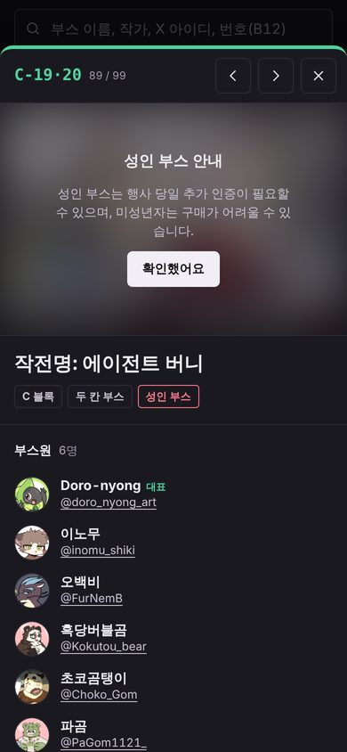

# 새 디자인 시험 페이지 (/newui)

## 무엇을 하나
- 사이트 주소 뒤에 `/newui`를 붙이면(예: `https://furryboothlist.hwch.workers.dev/newui`) 같은 부스 데이터를
  다른 디자인으로 보여 주는 **시험 페이지**가 열립니다. 기존 화면(`/`, `index.html`)은 그대로입니다.
- 디자인 방향: **동인 행사 카탈로그**(코미케식 서클컷 카탈로그). 2026-11-22 사용자가 결정 카드에서 고름.
  - 크림슨 표지 띠 + 그 아래 붙어 다니는 도구줄(검색, 전체/A/B/C 블록 탭, "상품 글 있는 부스만", 부스 수).
  - 부스컷을 1px 괘선 격자로 촘촘하게 붙여 보여 줌. 칸마다 아래에 부스 번호(`A-01`)·부스 이름·대표(외 N명).
  - 블록마다 색이 있음(A 크림슨, B 코발트, C 초록). 블록 머리의 큰 글자, 격자 윗선, 부스 번호 글자색이 그 색.
  - 넓은 PC 화면(1360px 이상)에서는 오른쪽 가장자리에 카탈로그 색인 탭(A/B/C)이 붙어 있고,
    스크롤하면 지금 보고 있는 블록 탭이 튀어나옴. 누르면 그 블록으로 이동.
  - 두 칸짜리 그림인 부스(B31-32, C19-20 등 가로가 긴 부스컷)는 격자 두 칸을 차지.
  - 칸 오른쪽 위 표시: ①②③(내 우선순위), 체크(방문함), 18+(성인 부스), 글 아이콘+숫자(반영된 상품 글 수).
- 검색: 부스 이름, 대표·부스원 이름, X 아이디, 부스 번호(`b12`, `B-12`, `c19` 처럼 쳐도 됨). 부스 이름 속 검색어는 노란색으로 표시.
  결과가 없으면 "조건 지우고 전체 보기" 버튼.
- 부스 상세: 칸을 누르면 PC는 오른쪽 서랍, 휴대폰은 아래에서 올라오는 시트로 열림.
  - 큰 부스컷, 부스 이름과 태그(블록·두 칸 부스·성인 부스), 부스원 목록(프로필 사진, 대표 표시, X 링크).
  - **내 기록(읽기 전용)**: 기존 화면에서 정한 우선순위·방문 상태·메모가 있으면 보여 주기만 함.
  - **상품 글**: 관리 화면에서 반영된 X 글을 3개씩 임베드("글 더 보기"로 3개씩 더). 12초 안에 안 뜨면 "X에서 보기" 링크로 바뀜.
  - 위쪽 ‹ › 버튼이나 키보드 ←/→ 로 지금 목록(검색·필터 결과) 안에서 이전/다음 부스로 넘김. Esc·바깥 클릭으로 닫힘.
  - 주소 뒤에 `#A01`처럼 붙이면 그 부스 상세가 바로 열림.
  - 성인 부스는 처음 열 때 부스컷을 흐리게 가리고 안내 문구 + "확인했어요" 버튼을 보여 줌(기존 화면에서 이미 확인했으면 바로 보임).
- 라이트/다크: 처음엔 기존 화면의 테마 설정을 따르고(없으면 브라우저 설정), 표지의 다크/라이트 버튼으로 바꿀 수 있음.

### 시험 페이지에 넣지 않은 것
로그인·동기화, 메모·방문 상태·예산·쓴 돈·우선순위·선입금 **입력**, 상품 글 숨기기, 관심 부스·선입금·최근 갱신 탭,
배치도, 행사 안내·시간표, 다국어(한국어만), 버그 제보, 오프라인용 서비스 워커 등록, 방문 통계 스니펫, 인용한 글 보기 버튼.
이런 건 표지의 "기존 화면" 버튼으로 돌아가서 씀.

## 왜 이렇게 했나
- 사용자가 PR #118로 들여온 디자인 스킬을 써 보고, 기존 화면을 건드리지 않고 새 디자인을 비교해 보고 싶어 함(2026-11-22).
- 스킬은 앱 화면 재디자인에 맞는 `impeccable`을 씀. 방향 후보 중 "퍼스트 클래스 탑승권"을 추천했지만,
  사용자는 "동인 행사 카탈로그"를 고름. 부스컷이 원래 서클컷이라 그림이 주인공이 되는 방향.
- 기존 사용자 기록을 깨지 않도록 **쓰기를 전혀 하지 않음**: `furstclass-*` 키는 읽기만 하고,
  예전 부스 번호(BOOTH_ID_RENAMES)·두 칸 부스 낱칸 번호도 메모리 안에서만 옮겨 읽음.
- 부스 데이터를 복사하지 않음: 관리 화면(admin.html)과 같은 방식으로 `index.html`의 `const BOOTHS = ...` 줄을 읽음.
  그래서 `tools/build_booths.py`로 부스 정보를 고치면 시험 페이지도 같이 바뀜.
- Firebase SDK(약 150KB)를 받지 않고, 공개 읽기인 Firestore 문서를 REST 주소로 한 번 읽음. 로그인 코드가 아예 없음.
- 글꼴은 사이트 CSP 때문에 외부 글꼴 없이 시스템 글꼴(Pretendard가 깔려 있으면 그것, 아니면 Apple SD Gothic Neo / Noto Sans KR / 맑은 고딕).

## 어떻게 구현했나
- 파일: 저장소 루트의 `newui.html` 하나(CSS·JS 모두 안에 있음). 다른 파일은 고치지 않음.
- `/newui` 주소: Cloudflare Workers 정적 배포의 기본 HTML 처리(`auto-trailing-slash`)가 `/newui` 요청에 `newui.html`을 돌려줌.
  (`/newui.html`로 열면 `/newui`로 옮겨짐.) 그래서 배포 설정을 바꿀 필요가 없음.
- 부스 목록: `loadBooths()`가 `/index.html`을 받아 `BOOTHS`, `BOOTH_ID_RENAMES` 줄을 정규식으로 읽음.
- 상품 글: `loadApproved()`
  1. 기존 화면이 10분 안에 받아 둔 `furstclass-booth-posts`(+ `furstclass-booth-posts-fetched-at`)가 있으면 그걸 읽음.
  2. 이 페이지가 10분 안에 받아 둔 값(sessionStorage `fcnewui-posts`)이 있으면 그걸 씀.
  3. 없으면 `https://firestore.googleapis.com/v1/projects/boothlist-4589c/databases/(default)/documents/boothPosts/main`을 읽음(15초 제한).
  `indexPosts()`가 부스별로 묶고 최신 글 먼저 정렬.
- 내 기록: `readMine()`이 `furstclass-priority`, `furstclass-visit-status`, `furstclass-notes`를 읽기만 함.
- 이 페이지가 쓰는 저장 키는 둘뿐: `fcnewui-theme`(localStorage, 테마 버튼), `fcnewui-posts`(sessionStorage, 상품 글 캐시).
  `furstclass-`로 시작하지 않아 기존 화면의 첫 방문 판정·동기화와 상관없음.
- X 임베드: `platform.twitter.com/widgets.js`의 `twttr.widgets.createTweet`(기존 화면과 같은 옵션).
- 서비스 워커: 등록하지 않음. 다만 기존 화면을 연 적이 있는 브라우저는 기존 서비스 워커가 이 페이지 요청도 네트워크 우선으로 처리함.
- 검색엔진에 안 걸리게 `<meta name="robots" content="noindex">`.

## 확인 방법
1. PC 브라우저에서 `https://furryboothlist.hwch.workers.dev/newui`를 엽니다. 부스컷 격자와 A/B/C 블록이 보이면 정상.
2. 검색칸에 `b12`를 치면 B-12 한 칸만, `곰`을 치면 부스원 이름에 곰이 들어간 부스가 나옵니다.
3. 칸을 누르면 오른쪽 서랍이 열리고 부스원·상품 글이 보입니다. ←/→ 키로 다음 부스로 넘어가는지 봅니다.
4. 표지의 다크/라이트 버튼으로 테마를 바꿔 봅니다. 휴대폰에서도 열어 3열 격자·아래 시트가 맞는지 봅니다.
5. 기존 화면(`/`)으로 돌아가 메모·우선순위·로그인 동기화가 전과 같은지 확인합니다(시험 페이지는 기록을 바꾸지 않음).
- 스크린샷(2026-11-22): 원본은 프로젝트 파일 `screenshots/newui/`, 줄인 사본은 이 폴더의 `images/newui/`.

| PC 라이트 목록 | PC 부스 상세 | 휴대폰 목록 | 휴대폰 성인 부스 상세(다크) |
|---|---|---|---|
|  |  |  |  |

## 변경 기록
- 2026-11-22 처음 만듦: 동인 행사 카탈로그 디자인의 부스 목록·검색·부스 상세 (이 PR)
