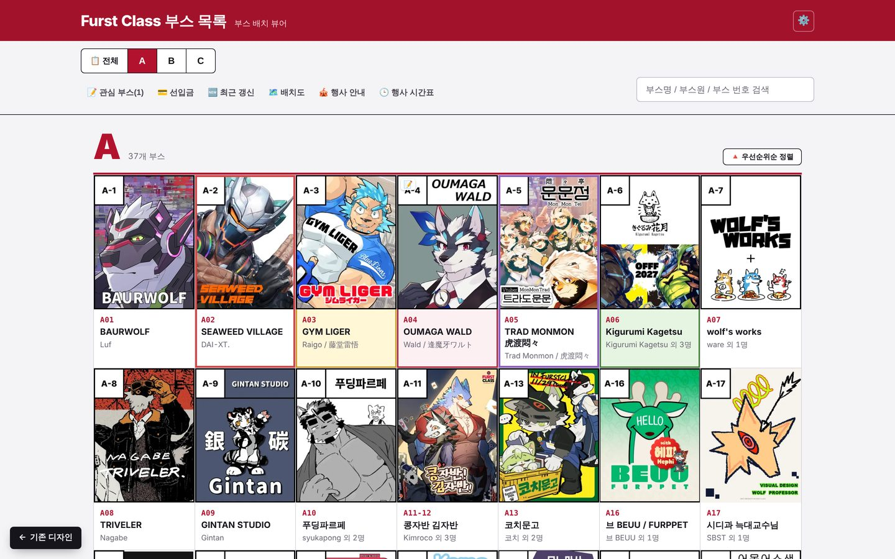
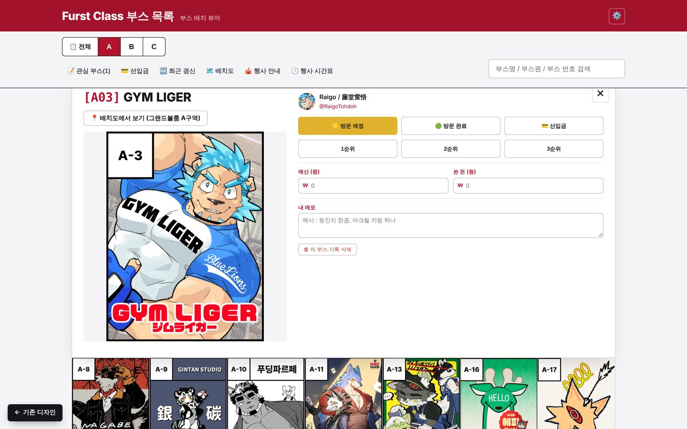
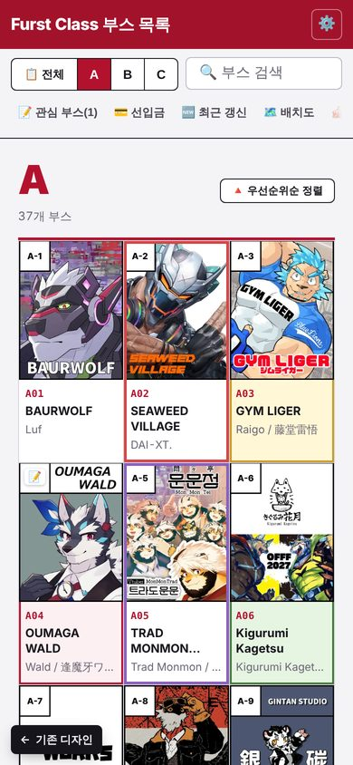
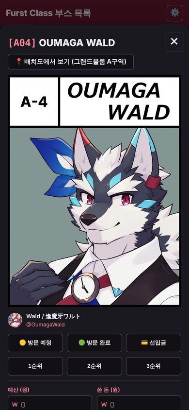

# 새 디자인 시험 페이지 (/newui)

## 무엇을 하나
- 사이트 주소 뒤에 `/newui`를 붙이면(예: `https://furryboothlist.hwch.workers.dev/newui`) **기존 화면의 모든 기능을 그대로 쓰면서
  겉모습만 바꾼** 시험 페이지가 열립니다. 기존 화면(`/`)은 그대로입니다.
- 기능은 기존 화면과 100% 같음: 부스 목록·검색·부스 상세(PC 펼침/휴대폰 창), 방문 예정·완료, 우선순위와 정렬, 예산·쓴 돈,
  메모, 선입금, 관심 부스·선입금·최근 갱신 탭, 배치도, 행사 안내·시간표, 다국어, 라이트/다크, Google 로그인과 자동 동기화,
  버그 제보, 오프라인. 저장 데이터도 같아서 한쪽에서 바꾼 기록이 다른 쪽에 그대로 보임.
- 디자인 방향: **동인 행사 카탈로그**(코미케식 서클컷 카탈로그). 2026-11-22 사용자가 결정 카드에서 고름.
  - 크림슨 표지 띠(사이트 제목·로그인·설정) 아래에 도구줄.
  - 전체·A·B·C는 한 덩어리로 붙은 버튼. 고른 블록 색(A 크림슨, B 코발트, C 초록)으로 칠해지고,
    큰 블록 글자와 격자 윗선도 그 색이 됨.
  - 관심 부스·선입금 같은 기능 탭은 카탈로그 목차처럼 밑줄 탭.
  - 부스 카드는 둥근 카드 대신 1px 괘선으로 촘촘하게 붙인 격자. 부스컷이 칸을 꽉 채우고, 아래에 부스 번호(블록 색)·이름·대표.
  - 메모·방문 예정·방문 완료는 칸 바탕색 + 칸 안쪽 테두리, 우선순위 ①②③ 색 테두리는 칸 안쪽에 그림.
  - PC 펼침 상세는 격자 한 줄을 차지하는 "펼친 면"(각진 모서리, 위쪽 검은 선), 휴대폰 부스 상세는 아래에서 올라오는 시트.
  - 왼쪽 아래 "← 기존 디자인" 버튼으로 기존 화면으로 돌아감(부스 상세가 열려 있을 땐 숨김).

## 왜 이렇게 했나
- 2026-11-22 처음에는 부스 목록·검색·상세만 담은 별도 페이지로 만들었는데, 사용자가 "기존 기능들은 그대로 둔 채로 바꿔 달라"고 함.
- 기능을 새로 다시 만들면 7천 줄짜리 index.html을 통째로 복사해야 하고, 앞으로 기능을 고칠 때마다 두 곳을 고쳐야 함.
  그래서 **기존 화면을 그대로 불러와 스타일시트 하나만 덧붙이는 방식**을 고름. 기능·데이터는 기존 화면 그 자체라 깨질 일이 없고,
  기존 화면이 바뀌면 시험 페이지도 자동으로 따라감.
- 기존 화면의 색은 거의 다 CSS 변수(`--paper`, `--card-bg`, `--chip-*`, `--panel-*` …)로 되어 있어서, 변수를 덮어쓰고
  카드·탭·상세 모양만 바꾸면 다크/라이트와 모든 탭에 함께 적용됨.
- 디자인 스킬은 앱 화면 재디자인에 맞는 `impeccable`을 씀(방향 후보를 결정 카드로 물어봄, 디자인 검사 `detect`로 확인).
- 글꼴은 사이트 CSP 때문에 외부 글꼴 없이 시스템 글꼴(Pretendard가 깔려 있으면 그것, 아니면 Apple SD Gothic Neo / Noto Sans KR / 맑은 고딕).

## 어떻게 구현했나
- `newui.html`: 작은 껍데기 페이지. `/index.html`을 받아 와서
  1. `</head>` 앞에 `<link rel="stylesheet" href="/newui.css?v=1">`(+ `noindex`)를 넣고,
  2. `<html>`에 `data-newui="1"`을 붙이고, 제목 뒤에 "(새 디자인)", `</body>` 앞에 "기존 디자인" 버튼을 넣은 뒤,
  3. `document.write`로 그 HTML을 그대로 그림. 그래서 index.html의 스크립트가 똑같이 실행됨.
  불러오지 못하면 "기존 화면으로 가기" 링크를 보여 줌.
- `newui.css`: 모든 규칙이 `html[data-newui]` 아래에만 걸려서 기존 화면(`/`)에는 영향이 없음.
  1. 색 변수(라이트·다크 둘 다) 2. 글꼴·선택색·포커스 3. 머리(표지 띠는 `.top-inner::before`로 화면 폭만큼 깜) 4. 블록 큰 글자
  5. 괘선 격자와 카드 상태 6. 상세 안쪽 버튼 7. 모달·휴대폰 시트 8. 기존 디자인 버튼 9. 휴대폰 10. 고른 블록 색(`:has()`).
  CSS를 고친 뒤에는 `newui.html`의 `?v=1` 숫자를 올려야 이미 연 브라우저에서도 바로 바뀜.
- `/newui` 주소: Cloudflare Workers 정적 배포의 기본 HTML 처리(`auto-trailing-slash`)가 `/newui` 요청에 `newui.html`을 돌려줌.
  배포 설정은 바꾸지 않음.
- 저장 데이터·localStorage 키·로그인·동기화는 index.html 코드 그대로(`furstclass-*`). 서비스 워커도 index.html이 등록하는 그대로.
- 방문 통계(Cloudflare Web Analytics)도 index.html 스니펫이 그대로 돌아서, 통계에서는 `/newui` 경로로 따로 보임.

## 확인 방법
1. PC 브라우저에서 `https://furryboothlist.hwch.workers.dev/newui`를 엽니다. 크림슨 띠와 괘선 격자가 보이면 정상.
2. 부스를 눌러 방문 예정·우선순위·예산·메모를 바꿔 보고, 기존 화면(`/`)에서도 똑같이 보이는지 확인합니다.
3. B, C 블록을 눌러 큰 글자·격자 윗선 색이 바뀌는지, 관심 부스·선입금·배치도 탭이 정상인지 봅니다.
4. 설정(톱니바퀴)에서 다크/라이트를 바꿔 보고, 휴대폰에서도 열어 3열 격자·아래 시트를 봅니다.
5. 로그인한 상태라면 기존 화면과 같은 계정으로 동기화되는지 봅니다.
- 스크린샷(2026-11-22): 원본은 프로젝트 파일 `screenshots/newui/`, 줄인 사본은 이 폴더의 `images/newui/`.

| PC 라이트 목록 | PC 펼침 상세 | 휴대폰 목록 | 휴대폰 부스 상세(다크) |
|---|---|---|---|
|  |  |  |  |

## 변경 기록
- 2026-11-22 처음 만듦: 동인 행사 카탈로그 디자인. 처음엔 목록·검색·상세만 담은 별도 페이지였다가, 같은 날 사용자 요청으로
  기존 화면을 그대로 불러와 스타일만 덮어쓰는 방식으로 바꿔 모든 기능을 살림 (이 PR)
